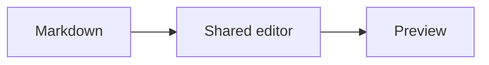

# Parity fixture

The same **Markdown document** belongs in the same editor, with *matching controls*, a [local reference](#details), and `inline code`.

## Details

A deliberately wrapped paragraph makes line width, text padding, and pane proportions visible. Café, naïve, and λ remain literal Unicode text. The editor and preview use the same shared Rust layout and theme rather than a separate browser presentation.

- Open a document
- Change its content
  - Preserve the bytes
  - Recover saved drafts
- Read the preview

> A block quotation should keep its border, indentation, and line spacing.

| Target | Interface | Persistence |
| --- | --- | --- |
| Desktop | egui | File adapter |
| Browser | egui | Draft adapter |

```rust
fn shared_editor() -> &'static str {
    "one application, two runtimes"
}
```



---

### Final section

A second paragraph stays at the same position when changing themes or switching between Edit, Split, and Preview. Toolbar icons, filename input, pane borders, and the divider remain measurable independently of font rasterization.
